<div align="center">

# 💼 Payroll Management System — Java Swing · MySQL · Test Automation

### A desktop payroll app (employees, salary engine, payslip and cheque) with a 260-test suite: JUnit 5, Cucumber BDD, AssertJ-Swing UI robots and real-MySQL integration tests, all running in GitHub Actions

[](https://git.io/typing-svg)

<!-- ============ STATUS BAR ============ -->
[](https://github.com/rbchy/PayrollManagementSystems_Automation_Java_MySql_Selenium/actions/workflows/ci.yml)


</div>

---

## 📌 At a Glance

<table>
<tr>
<td width="50%" valign="top">

**🙋 What this is**

A **Java Swing** desktop application for small-business payroll, backed by **MySQL**. It covers:

- employee records: add, view, update, search, delete
- a **payroll engine**: normal / overtime / double-time / extended / holiday / special-work pay, bonus, 20 % tax, 10 % medical
- **payslip and cheque** generation, with the amount in words (`ONE THOUSAND TWO HUNDRED AND 00/100`)

The business logic lives in plain classes (no Swing, no JDBC), so it is unit-tested directly. The same rules are also written as **Cucumber** scenarios. The Swing tabs are clicked by **AssertJ-Swing** robots on a virtual display. Every SQL statement the app uses runs against a **real MySQL 8** database in CI.

</td>
<td width="50%" valign="top">

**📍 Quick facts**

| | |
|---|---|
| 🖥️ **App** | Java 21 Swing, 9 tabs |
| 🗄️ **Database** | MySQL 8, `payroll_db.employees` (35 columns) |
| 🧪 **Tests** | 260: unit 154 · BDD 85 · UI 8 · schema 9 · DB 4 |
| ✅ **CI** | 260 / 260 · `mvn verify` ≈ 35 s |
| 🧱 **Design** | Swing tabs → pure helper classes → JDBC |
| 📊 **Reports** | Surefire · Cucumber HTML (masterthought) |
| 📦 **Output** | runnable fat JAR built on every push |

</td>
</tr>
</table>

---

## ✅ Latest Results (GitHub Actions)

| Layer | Classes / features | Tests | ✅ Passed | Runs against |
|---|---|---:|---:|---|
| 🧩 Unit (logic) | 9 classes | 130 | 130 | plain JVM |
| 🛡️ Security | `SecurityTest` | 24 | 24 | plain JVM |
| 🥒 Cucumber BDD | 8 `.feature` files | 85 | 85 | plain JVM + MySQL (`@db`) |
| 🖱️ Swing UI | `WelcomeTabTest`, `RefreshTabTest` | 8 | 8 | Xvfb + fluxbox, `java.awt.Robot` |
| 📐 SQL ↔ schema | `SqlSchemaConsistencyTest` | 9 | 9 | `db/setup_payroll_db.sql` |
| 🗄️ DB integration | `EmployeeSqlIntegrationTest` | 4 | 4 | MySQL 8 service container |
| **Total** | | **260** | **260** | |

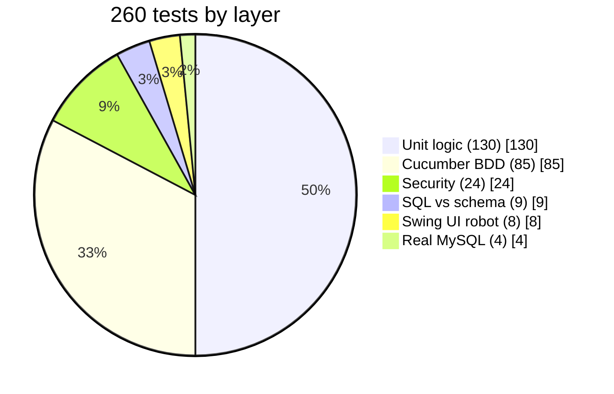

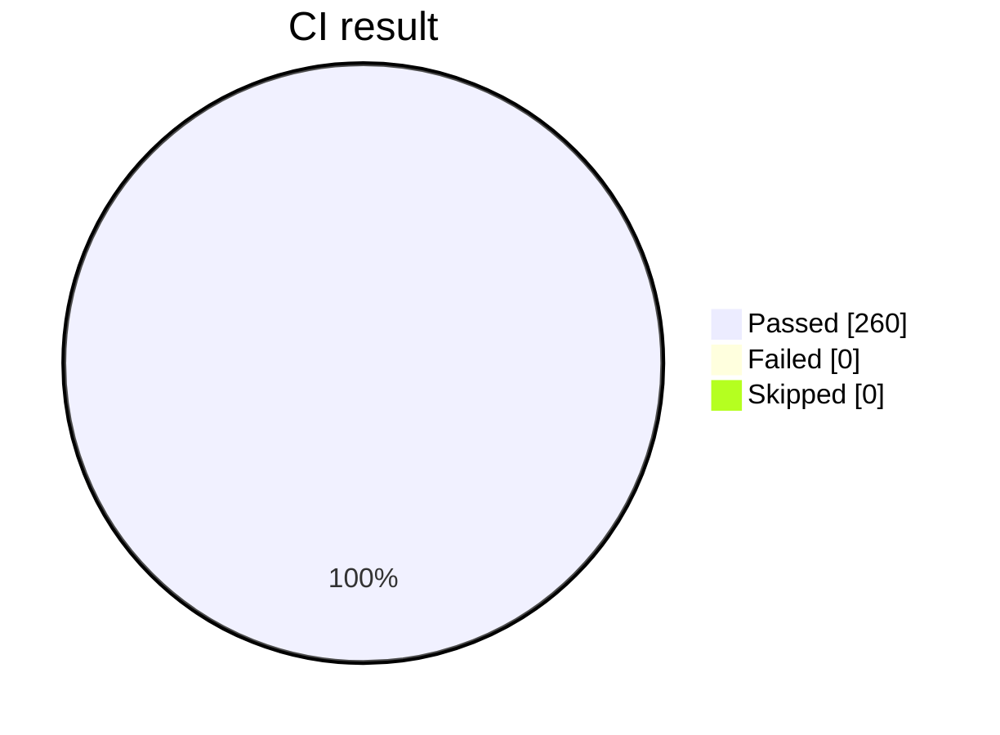

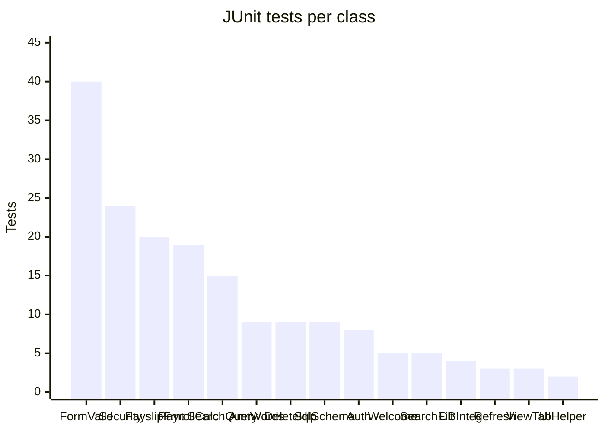

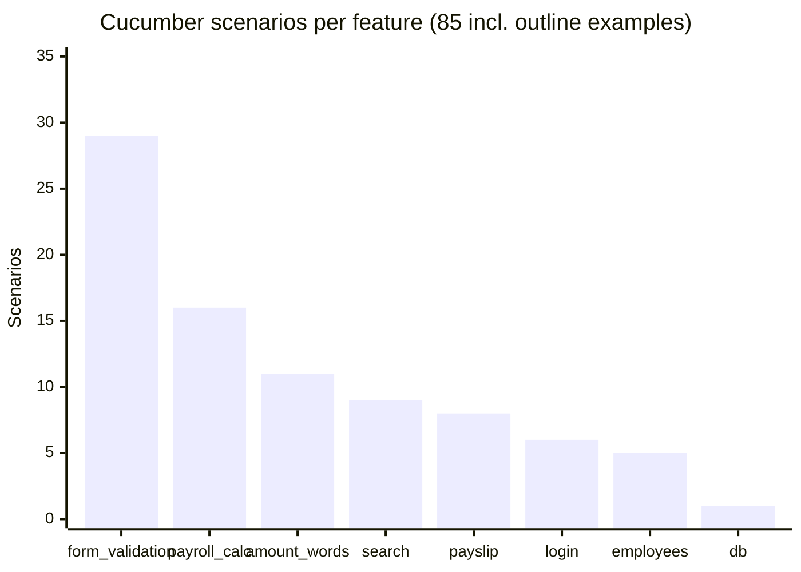

> The `@db` scenario and `EmployeeSqlIntegrationTest` **skip** (not fail) on a machine without MySQL. In CI a step checks that they actually ran.

---

## 🏗️ Architecture

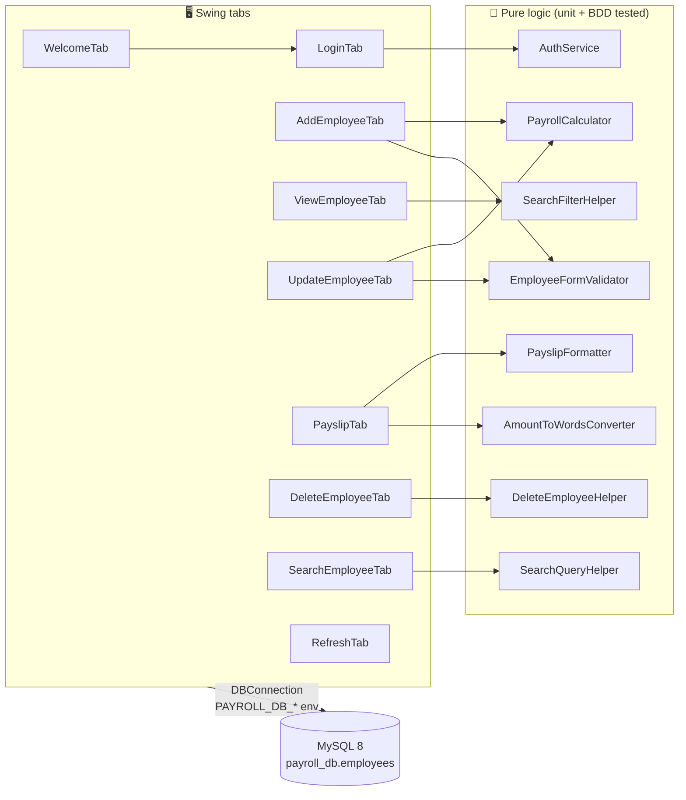

### CI pipeline

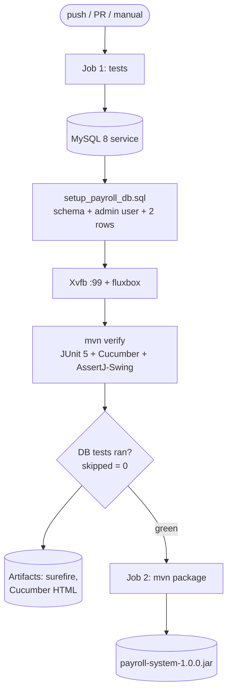

### Payslip flow

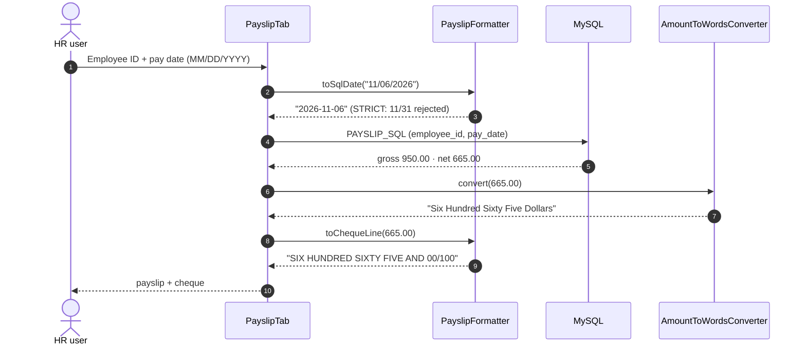

### Employee record lifecycle

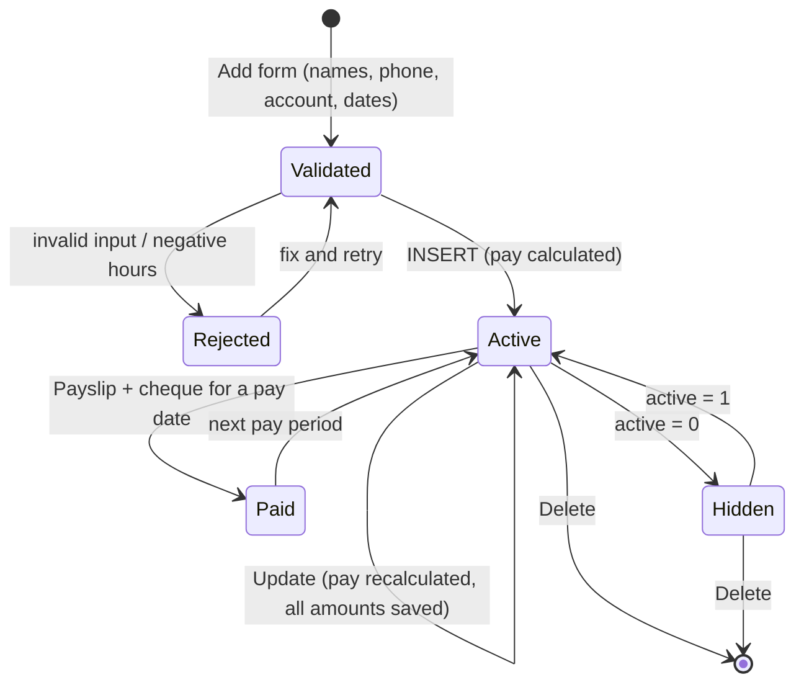

---

## 💰 Payroll Rules

| Component | Formula | Multiplier |
|---|---|---:|
| Normal pay | `min(totalHours, 40) × rate` | 1.0 |
| Overtime | `overtimeHours × rate × 1.5` | 1.5 |
| Double time | `doubletimeHours × rate × 2` | 2.0 |
| Extended / Holiday / Special work | `hours × rate` | 1.0 |
| Gross | sum of the above + bonus | |
| Tax | `gross × 20 %` | |
| Medical | `gross × 10 %` | |
| **Net** | `gross − tax − medical` | |

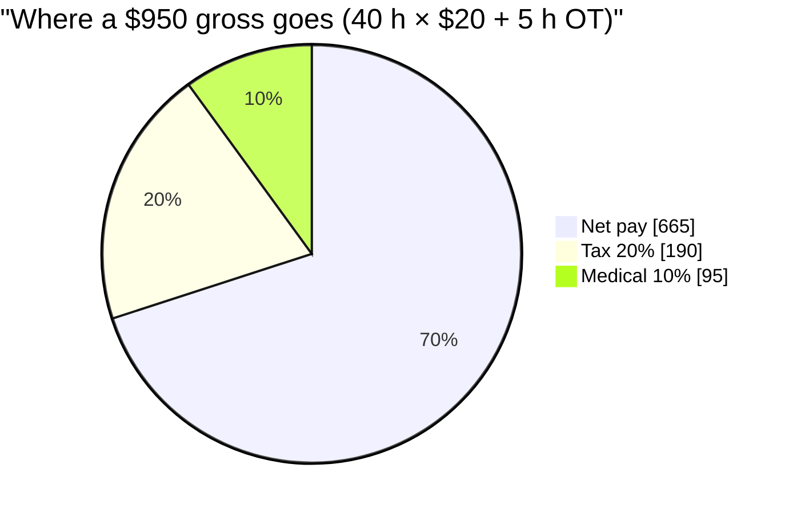

Negative pay rate, hours or bonus are rejected. Money is rounded half-up to cents.

---

## 🗄️ Database

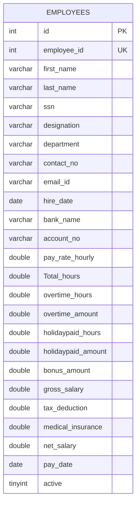

<sub>Simplified: the table also has doubletime, extended and special-work hours/amounts, `salary`, `ytd_gross` and `total_deductions`. See [`db/setup_payroll_db.sql`](db/setup_payroll_db.sql).</sub>

---

## 🧪 Test Coverage

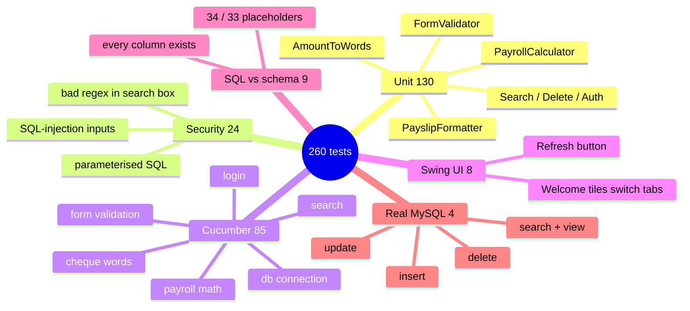

---

## ▶️ Running Locally

**Prerequisites:** JDK 21, Maven 3.9+, MySQL 8.

```bash
# 1. Database: creates payroll_db, user admin/admin123 (local demo only) and 2 sample rows
mysql -u root -p < db/setup_payroll_db.sql

# 2. Tests + Cucumber HTML report (target/cucumber-html-reports)
mvn clean verify

# 3. Run the app
mvn -DskipTests package
java -jar target/payroll-system-1.0.0.jar     # demo login: admin / admin123
```

| Setting | Env var | `-D` property | Default |
|---|---|---|---|
| JDBC URL | `PAYROLL_DB_URL` | `payroll.db.url` | `jdbc:mysql://localhost:3306/payroll_db` |
| DB user | `PAYROLL_DB_USER` | `payroll.db.user` | `admin` |
| DB password | `PAYROLL_DB_PASSWORD` | `payroll.db.password` | `admin123` |

> The Swing UI tests (`@Tag("ui")`) need a display. Without one they fail with `HeadlessException`; exclude them with `mvn test -DexcludedGroups=ui`. Without MySQL the DB tests skip.

---

## 📁 Project Structure

```text
PayrollManagementSystems_Automation_Java_MySql_Selenium/
├── .github/workflows/ci.yml        # MySQL service + Xvfb tests, fat-JAR job
├── db/setup_payroll_db.sql         # schema, app user, sample rows
├── pom.xml                         # Java 21 · JUnit 5 · Cucumber 7 · AssertJ-Swing · shade
└── src/
    ├── main/java/com/payroll/
    │   ├── PayrollTabbedGUI.java   # main window (entry point)
    │   ├── *Tab.java               # Welcome, Login, Add, View, Update, Payslip, Delete, Search, Refresh
    │   ├── PayrollCalculator.java  # pay engine
    │   ├── AmountToWordsConverter.java · PayslipFormatter.java
    │   ├── EmployeeFormValidator.java · AuthService.java
    │   ├── SearchQueryHelper.java · SearchFilterHelper.java · DeleteEmployeeHelper.java
    │   └── DBConnection.java       # JDBC, settings from env
    └── test/
        ├── java/com/payroll/       # 15 JUnit classes (unit, security, UI, schema, DB)
        ├── java/com/payroll/cucumber/  # step definitions + runner
        └── resources/features/     # 8 Gherkin feature files
```

---

## 🧹 Maintenance Log

| Area | Before | Now |
|---|---|---|
| **Update Employee** | SQL used `bankname`, `accountno`, `holiday_paid_hours`, `special_work_hours`; none exist, so **every update failed** with *Unknown column* | correct columns; also saves `salary` and every pay-component amount. Proven against real MySQL |
| Cheque line | `ONE THOUSAND TWO HUNDRED` (no cents) and `ONE AND FIFTY/100` | `… AND 00/100`, `ONE AND 50/100` |
| Amount in words | `One Dollars`, `One Cents` | `One Dollar`, `One Cent` |
| DB setup script | comment promised `admin@'%'`, only `admin@localhost` was created → TCP / Docker clients denied | both users created |
| `mvn verify` | Cucumber report plugin mis-configured → **build failed after the tests** | `inputDirectory` + `jsonFiles`; HTML report generated |
| DB credentials | hard-coded in `DBConnection` | `PAYROLL_DB_*` env / `-D` (same defaults) |
| SQL | inline strings in the Swing tabs | constants checked by `SqlSchemaConsistencyTest` + real-MySQL test |
| Repo | `dependency-reduced-pom.xml` committed | removed; `.gitignore` |
| README | linked a missing test plan and LICENSE, wrong clone URL | rewritten from the code and the CI run |
| CI | none | GitHub Actions: MySQL 8 + Xvfb + fluxbox, JAR artifact |

---

## 📈 Roadmap

- [x] CI with a real MySQL database and the Swing UI tests
- [x] Cheque wording in standard `AND nn/100` form
- [ ] `payroll_history` table so YTD gross is a real `SUM` per year
- [ ] Hash the login password instead of a fixed demo pair
- [ ] Export payslips to PDF (iText 7 is already a dependency)
- [ ] Excel payroll report (Apache POI is already a dependency)

---

## 🔗 Related Projects

| Repo | What it is |
|---|---|
| [InventoryControlManagement_JavaMySql](https://github.com/rbchy/InventoryControlManagement_JavaMySql) | Java Swing + MySQL inventory app with CI |
| [BhojanAloy-Food-Coffee-Shop-POS-System](https://github.com/rbchy/BhojanAloy-Food-Coffee-Shop-POS-System) | Java POS system with MySQL |
| [PPES-Pharmaceutical-Packaging-Management](https://github.com/rbchy/PPES-Pharmaceutical-Packaging-Management) | Pharma packaging management system |
| [AppiumMobileAutomation](https://github.com/rbchy/AppiumMobileAutomation) | Appium + TestNG on an Android emulator in CI |
| [rbchy](https://github.com/rbchy/rbchy) | Profile and full project list |

---

## ⚠️ Disclaimer

Educational / portfolio project. Tax and insurance rates are fixed demo values, not real payroll law. Use a payroll specialist for real payroll. `admin / admin123` are local demo credentials only.

---

## 👤 Authors

<div align="center">

**Ranajit Baran Chowdhury (RB Chowdhury)** & **Rezaul Karim**
QA Automation Engineer / SDET · West Norriton, Pennsylvania, USA

[](https://www.linkedin.com/in/rbchy/)
[](https://github.com/rbchy)
[](https://rbchy.github.io/rbchy/)
[](https://rbc6543.wixsite.com/rbc-portfolio)
[](mailto:chyranajit@gmail.com)

⭐ *If this project helps you, a star on the repo is appreciated.*

</div>
